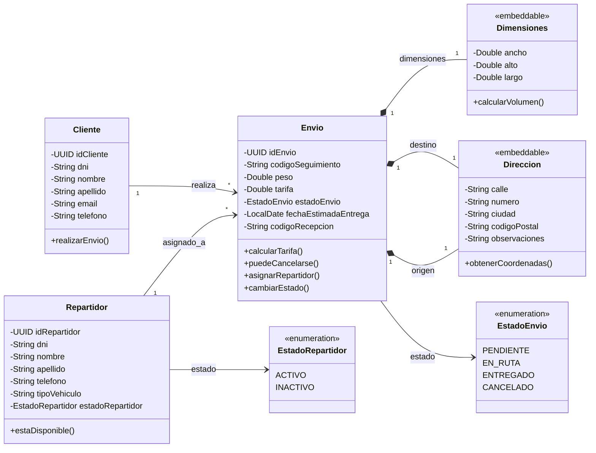

# Shipment Service 🚚📦

## 📄 Descripción del Proyecto

**Shipment Service** es un microservicio backend encargado de la gestión integral de envíos, asignación de repartidores, actualización de estados de paquetes y cálculo dinámico de tarifas de envío. Este repositorio contiene el desarrollo correspondiente al **Sprint 1** del proyecto final de la materia **Desarrollo y Arquitecturas Avanzadas de Software**, enfocado en la arquitectura base, la gestión del ciclo de vida de los envíos y la implementación del cálculo tarifario.


## Modelo de Dominio: Sistema Orientado a la Gestión y Seguimiento de Envíos.

Este documento describe el modelo de dominio para la gestión y seguimiento de envíos, asignación de repartidores y administración de clientes.

---

## 📊 Diagrama del Modelo de Dominio (UML)



---

## 📝 Descripción del Dominio

El sistema centraliza la operativa de recepción, procesamiento, asignación y entrega de paquetes o encomiendas.

### 1. Entidades Principales

* **`Cliente`**: Representa a la persona o entidad que solicita y realiza los envíos en la plataforma.
  * *Atributos*: Identificador único (`idCliente`), documento (`dni`), datos personales y de contacto (`nombre`, `apellido`, `email`, `telefono`).
  * *Métodos*: `realizarEnvio()`.

* **`Repartidor`**: Es el encargado de transportar y entregar los envíos asignados.
  * *Atributos*: Identificador único (`idRepartidor`), información personal (`dni`, `nombre`, `apellido`, `telefono`), vehículo (`tipoVehiculo`) y su estado operacional (`estadoRepartidor`).
  * *Métodos*: `estaDisponible()`.

* **`Envio`**: Es el agregado principal del sistema, representa el paquete o encomienda a ser entregado.
  * *Atributos*: Identificador (`idEnvio`), código único de rastreo (`codigoSeguimiento`), peso, precio (`tarifa`), estado actual (`estadoEnvio`), fecha estimada de recepción y un código de seguridad para la entrega (`codigoRecepcion`).
  * *Métodos*: `calcularTarifa()`, `puedeCancelarse()`, `asignarRepartidor()`, `actualizarEstado()`.

---

### 2. Objetos Embebidos (embeddable)

Son objetos inmutables definidos por sus atributos y no por una identidad propia:

* **`Dimensiones`**: Define el tamaño físico del paquete (`ancho`, `alto`, `largo`). Posee el método `calcularVolumen()`.
* **`Direccion`**: Define las ubicaciones geográficas involucradas (`calle`, `numero`, `ciudad`, `codigoPostal`, `observaciones`). Posee el método `obtenerCoordenadas()`.

---

### 3. Enumeraciones (Enumerations)

* **`EstadoRepartidor`**: Define la disponibilidad operacional del repartidor.
  * `ACTIVO`
  * `INACTIVO`

* **`EstadoEnvio`**: Representa el ciclo de vida por el que pasa un envío.
  * `PENDIENTE`
  * `EN_RUTA`
  * `ENTREGADO`
  * `CANCELADO`

---

### 4. Relaciones y Composición

1. **Cliente → Envio (`1` a `*`)**: Un cliente puede realizar uno o varios envíos (*realiza*).
2. **Repartidor → Envio (`1` a `*`)**: Un repartidor puede tener múltiples envíos asignados (*asignado_a*).
3. **Envio 🡒 Dimensiones (Composición `1:1`)**: Cada envío se compone intrínsecamente de un conjunto de dimensiones físicas.
4. **Envio 🡒 Direccion (Composición `1:1` doble)**: Un envío posee obligatoriamente una dirección de **origen** y una dirección de **destino**.

---


## 🚀 Funcionalidades del Sprint 1

Durante este primer sprint, se han completado e integrado las siguientes funcionalidades base:

* 📦 **Gestión de Envíos:** Creación, consulta y actualización del ciclo de vida de los envíos.

* 💰 **Cálculo de Tarifas (`feat/calcular-tarifa`):** Módulo para el cálculo dinámico del costo de envío basado en reglas de negocio.

* 🚚 **Gestión de Repartidores (`feature/gestion-repartidores`):** Asignación y manejo del flujo de trabajo de repartidores.

* 🕒 **Histórico de Auditoría e Historial de Estados (`feat/actualizacion-de-estado-e-historico-de-auditorias`):** Trazabilidad completa sobre los cambios de estado de cada paquete.

* 🛡️ **Manejador Global de Excepciones (`feat/manejador-global-excepciones`):** Control estandarizado de errores HTTP (`@ControllerAdvice`).

* 🔄 **Patrón DTO (`feat/clases-dto`):** Desacoplamiento de las entidades de dominio y la capa de exposición mediante Data Transfer Objects.

* 📖 **Documentación Interactiva (Swagger):** Integración de OpenAPI/Swagger UI para pruebas directas de los endpoints.

---

## 🛠️ Tecnologías Utilizadas

* **Lenguaje:** Java 25

* **Framework:** Spring Boot 3

* **Módulos Spring:** Spring Web, Spring Data JPA, Spring Validation

* **Gestor de Dependencias:** Apache Maven

* **Documentación API:** Swagger / OpenAPI 3

* **Control de Versiones:** Git (Flujo GitFlow con ramas `main`, `develop` y ramas `feat/*`)

---

## 📁 Estructura Física del Proyecto

- 📁 **shipment-service/**
    * 📁 **src/main/java/com/example/shipment/**
        * 📁 **controller/** — Controladores REST y exposición de endpoints de la API
        * 📁 **service/** — Contratos de servicio, lógica de negocio e implementaciones
        * 📁 **model/** — Entidades de dominio, mapeo JPA/ORM y enums de estado
        * 📁 **dto/** — Objetos de transferencia de datos de entrada (Request) y salida (Response)
        * 📁 **repository/** — Interfaces de persistencia y consultas a la base de datos
        * 📁 **exception/** — Manejador global (`@ControllerAdvice`) y excepciones personalizadas
    * 📁 **src/main/resources/** — `application.yml`, configuraciones y scripts de la base de datos
    * 📁 **src/test/java/.../** — Pruebas unitarias e integración de los componentes
    * 📄 **pom.xml** — Descriptor de dependencias Maven y plugins del proyecto
    * 📄 **README.md** — Documentación técnica del servicio

---

## 🌿 Estructura de Ramas (GitFlow)

El desarrollo del Sprint 1 siguió una estrategia de ramificación organizada:

| Rama                                                     | Propósito / Descripción                                    | 
|----------------------------------------------------------|------------------------------------------------------------| 
| `main`                                                   | Código de producción listo para despliegue.                | 
| `develop`                                                | Rama principal de integración para el Sprint 1.            | 
| `feat/calcular-tarifa`                                   | Implementación de la lógica de cálculo de costo por envío. | 
| `feat/gestion-de-envios`                                 | ABM / CRUD principal del servicio de envíos.               | 
| `feature/gestion-repartidores`                           | Control y asignación de repartidores.                      | 
| `feat/actualizacion-de-estado-e-historico-de-auditorias` | Módulo de seguimiento de auditorías y estados.             | 
| `feat/manejador-global-excepciones`                      | Lógica centralizada para respuestas de error.              | 
| `feat/clases-dto`                                        | Definición de DTOs de entrada y salida.                    | 
| `feat/agregar-swagger`                                   | Configuración de documentación de la API.                  | 

---

## ⚙️ Instalación y Ejecución Local

### Prerrequisitos

* Java Development Kit (JDK) 25.

* Apache Maven 3.8+ instalado (o utilizar `./mvnw`).

* Base de datos configurada (H2 / PostgreSQL / MySQL según `application.yaml`).

### Pasos

1. **Clonar el repositorio:**

   ```
   git clone https://github.com/Logitrack-Penguin/shipment-service.git
   cd shipment-service
   
   ```

2. **Posicionarse en la rama de desarrollo:**

   ```
   git checkout develop
   
   ```

3. **Compilar el proyecto:**

   ```
   ./mvnw clean compile
   
   ```

4. **Ejecutar la aplicación:**

   ```
   ./mvnw spring-boot:run
   
   ```

El servicio iniciará por defecto en el puerto `8080`.

---

## 📚 Documentación de la API (Swagger UI)

Una vez que la aplicación esté ejecutándose, puedes explorar y probar los endpoints HTTP desde el navegador:

* **Swagger UI:** `http://localhost:8080/swagger-ui.html` o `http://localhost:8080/swagger-ui/index.html`

* **OpenAPI Spec:** `http://localhost:8080/v3/api-docs`

## 📋 Entregables del Sprint 1

* \[x\] Arquitectura multicapa limpia (Controller, Service, Repository, DTO, Entity).

* \[x\] Endpoints para el cálculo dinámico de tarifa.

* \[x\] Manejo uniforme de errores REST.

* \[x\] Persistencia e historial de cambio de estados para envíos.

* \[x\] Interfaz de Swagger operativa.